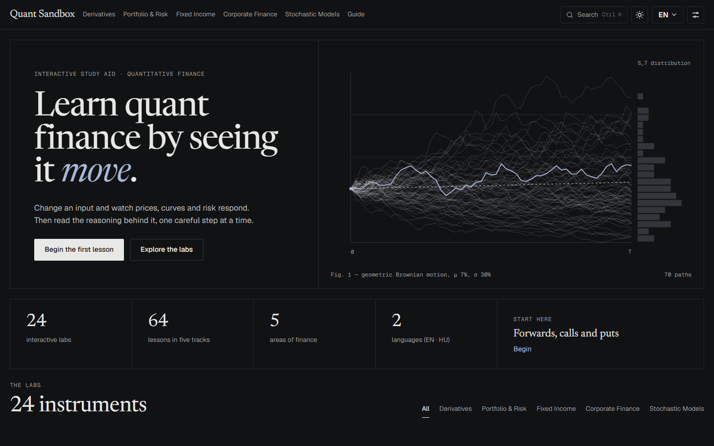
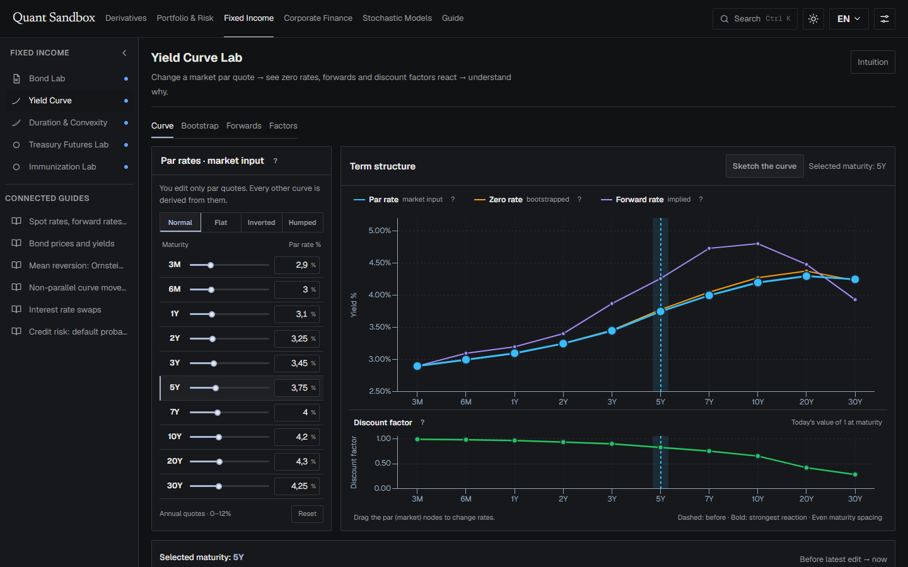
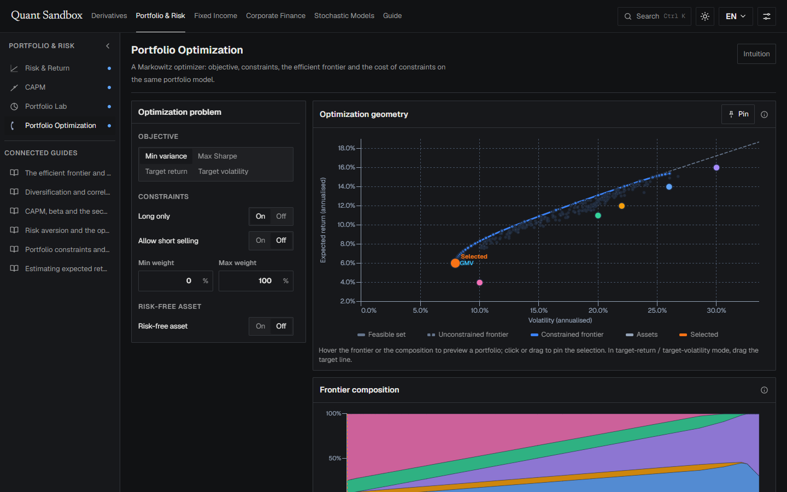
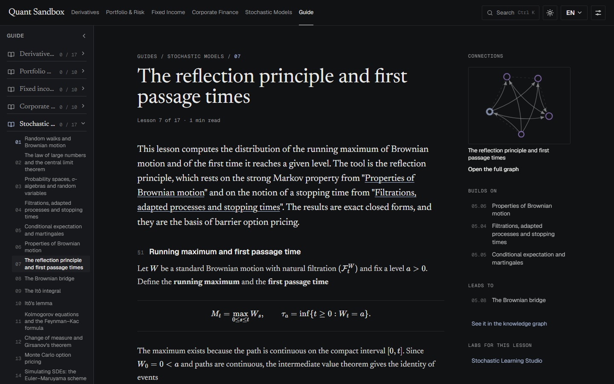
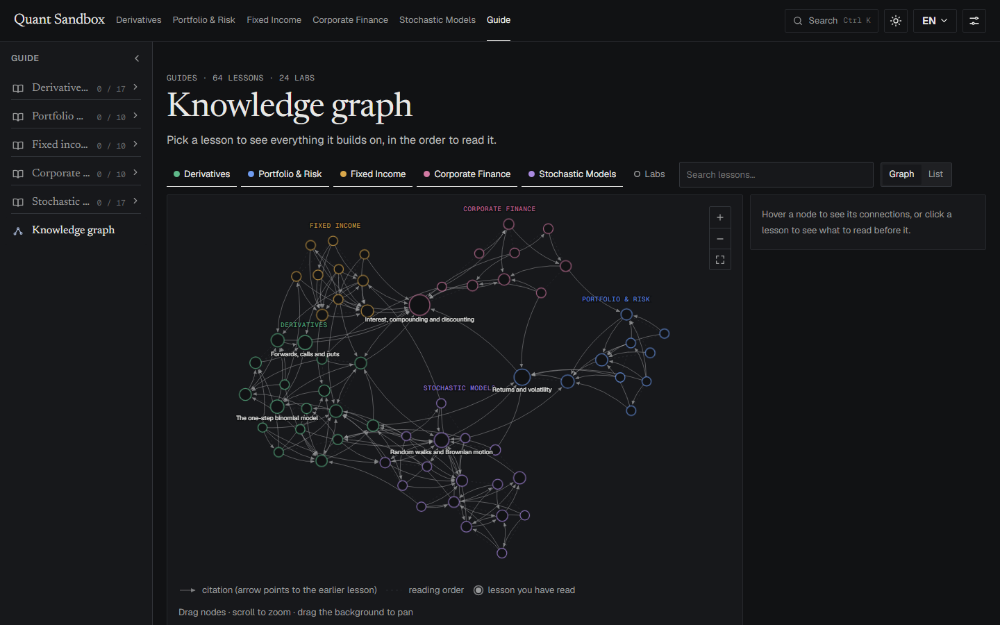
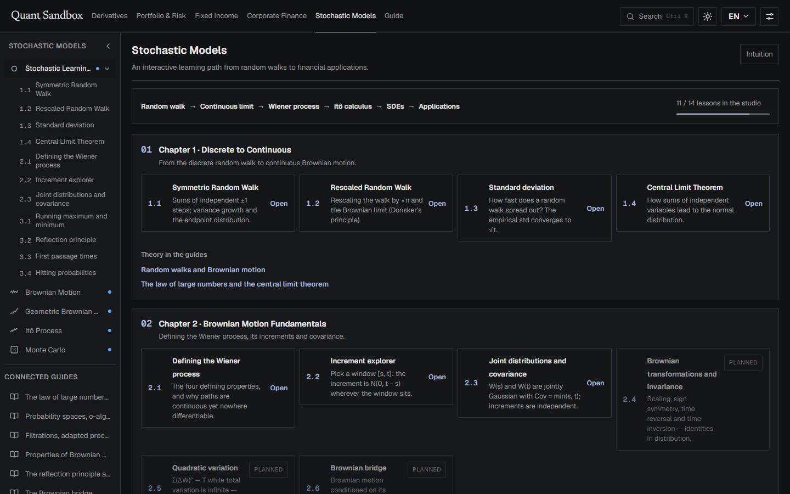
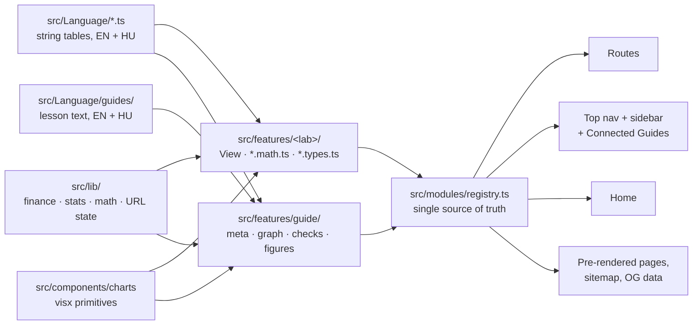

# Quant Sandbox

**Interactive quantitative finance labs and a guide curriculum to match.**
Change an input and watch prices, curves and risk respond. Then read the reasoning behind it, one careful step at a time.

[](https://quantsandbox.dev)
[](https://quantsandbox.dev/hu)
[](https://react.dev)
[](https://www.typescriptlang.org)
[](https://vite.dev)
[](#license)

[](https://quantsandbox.dev)

The app is a study aid for students of the **Insurance and Financial Mathematics programme at ELTE and Corvinus University of Budapest**. Its goal is to make the concepts that feel abstract in lectures and textbooks tangible: drag a parameter, predict an outcome, and see the maths respond.

Maintenance follows a rather informal *"I work on it when I feel like it"* model. If you would like to see additional topics implemented, feel free to reach out.

| | |
|---|---|
| **25** interactive labs | across derivatives, portfolio & risk, fixed income, corporate finance and stochastic models |
| **5** trading desk games | missions, live help, a playthrough and a debrief on simulated markets |
| **64** guide lessons | in five tracks, read in order, each with a figure, a worked example and self-check questions |
| **2** languages | English and Hungarian, every page and every lesson |
| **0** cookies | settings and reading progress stay in your browser; lab inputs live in the URL so a link shares your exact setup |

---

## Contents

- [The labs](#the-labs)
- [The desks](#the-desks)
- [The guides](#the-guides)
- [Stochastic Learning Studio](#stochastic-learning-studio)
- [How it is built](#how-it-is-built)
- [Running the project](#running-the-project)
- [Contributing and roadmap](#contributing-and-roadmap)
- [License](#license)

---

## The labs

Each lab is a dense workspace: controls on the left, a dominant chart on the right, an intuition drawer and a searchable intro with FAQ below. Labs favour interaction over sliders-and-a-line-chart:

- **Direct manipulation** — drag strikes, cash-flow bars, curve knots and portfolio points on the chart itself.
- **Sketch to define** — draw a yield curve or a payoff freehand and let the lab bootstrap or replicate it.
- **Predict, then reveal** — place a guess before seeing the answer; the gap is scored.
- **Playback** — play, pause, step and reseed simulations; paths fall into histograms.
- **Pin and compare** — snapshot the current curves and draw later changes over the ghost.
- **Scenario shocks** — parallel shifts, steepeners, flatteners and butterflies, before and after.

[](https://quantsandbox.dev/yield-curve)

### Derivatives

| Lab | What you do |
|---|---|
| [Payoff Lab](https://quantsandbox.dev/payoff) | Build option strategies and read the payoff at expiry; sketch a payoff and get the positions that replicate it. |
| [Binomial](https://quantsandbox.dev/binomial) | Price an option step by step on a recombining tree, with the replicating portfolio at every node. |
| [Black–Scholes](https://quantsandbox.dev/black-scholes) | Closed-form price and every Greek across spot and time, as 2D curves or a 3D surface. |
| [Heston](https://quantsandbox.dev/heston) | Stochastic volatility, simulated paths and the shape of the implied-volatility smile (priced in a web worker). |
| [Delta Hedging](https://quantsandbox.dev/delta-hedging) | Rebalance a hedge along a path and watch the replication error. |

### Portfolio & risk

| Lab | What you do |
|---|---|
| [Risk & Return](https://quantsandbox.dev/risk-return) | Mean, volatility, correlation and Sharpe from returns; the capital allocation line. |
| [CAPM](https://quantsandbox.dev/capm) | Beta, the security market line and alpha; estimate β by eye against the regression. |
| [Portfolio Lab](https://quantsandbox.dev/portfolio-lab) | Diversification with two to many assets, weights, correlations and risk decomposition. |
| [Portfolio Optimization](https://quantsandbox.dev/efficient-frontier) | A Markowitz optimiser: objective, constraints, the frontier, the tangency portfolio and the cost of constraints. |

[](https://quantsandbox.dev/efficient-frontier)

### Fixed income

| Lab | What you do |
|---|---|
| [Bond Lab](https://quantsandbox.dev/bond-pricing) | Price, yield and the coupon effect on one curve; drag cash flows on a timeline. |
| [Yield Curve](https://quantsandbox.dev/yield-curve) | Bootstrap zeros, forwards and discount factors from par quotes; sketch a curve; apply named shocks. |
| [Duration & Convexity](https://quantsandbox.dev/duration-convexity) | First- and second-order rate risk side by side; predict the price change before revealing it. |
| [Treasury Futures Lab](https://quantsandbox.dev/treasury-futures) | Conversion factors, basis and the cheapest-to-deliver as yields move. |
| [Interest Rate Swap](https://quantsandbox.dev/interest-rate-swap) | Par swap rate from the curve, the fixed and floating legs, and the swap value after the curve moves. |
| [Immunization Lab](https://quantsandbox.dev/immunization) | Match duration so that rate moves cancel out, then shock the curve and rebalance. |

### Corporate finance

| Lab | What you do |
|---|---|
| [Time Value of Money](https://quantsandbox.dev/tvm) | Compounding, discounting and annuities. |
| [NPV / IRR](https://quantsandbox.dev/npv-irr) | Project cash flows, hurdle rates and the NPV profile. |
| [Valuation (DCF)](https://quantsandbox.dev/valuation) | Forecast cash flows, discount them, add terminal value; the bridge to equity value. |
| [Cost of Capital (WACC)](https://quantsandbox.dev/wacc) | Cost of equity, cost of debt and the blend. |
| [Capital Structure](https://quantsandbox.dev/capital-structure) | Leverage, taxes and firm value. |

### Stochastic models

| Lab | What you do |
|---|---|
| [Stochastic Learning Studio](https://quantsandbox.dev/stochastic-models) | A chaptered path from random walks to Brownian motion, by experiment (see below). |
| [Brownian Motion](https://quantsandbox.dev/brownian-motion) | Drift, volatility and seeded sample paths. |
| [Geometric Brownian Motion](https://quantsandbox.dev/gbm) | Log-normal price paths and their expected value. |
| [Itô Process](https://quantsandbox.dev/ito-process) | Why log prices drift at μ − ½σ². |
| [Monte Carlo](https://quantsandbox.dev/monte-carlo) | Price by simulation and watch the estimate converge. |

---

## The desks

Five of the labs have a **trading desk** next to them: a terminal-style game where you run a book through a simulated market, one step at a time, against a mission. Each desk has five missions with live objectives, a help drawer (*Next move*, *What if*, *Guide*), a scripted playthrough you can take over at any step, and a debrief that splits your result into its sources and replays simple rules on the same market path.

| Desk | Lives under | What you run |
|---|---|---|
| [Hedging desk](https://quantsandbox.dev/delta-hedging/desk) | Delta Hedging | A short option book, day by day: stock and option orders, delta and gamma limits, P&L attribution. |
| [ALM desk](https://quantsandbox.dev/immunization/desk) | Immunization Lab | A pension liability funded with 2y, 5y and 12y bonds; keep duration (and in one mission convexity) matched while the curve shifts and twists. |
| [Rates desk](https://quantsandbox.dev/yield-curve/desk) | Yield Curve | A bond book hedged with Treasury futures through level, slope and curvature moves; conversion factors and the cheapest-to-deliver. |
| [Portfolio desk](https://quantsandbox.dev/portfolio-lab/desk) | Portfolio Lab | A multi-asset fund, month by month, against a volatility target and a benchmark, through changing correlations. |
| [Retirement desk](https://quantsandbox.dev/tvm/desk) | Time Value of Money | A 1,000,000 pension pot over thirty years: choose each year's withdrawal and equity share, with Monte Carlo success odds. |

The same path replays for the same seed, so a run can be compared with the rules in the debrief or shared by link. The **[Sandbox](https://quantsandbox.dev/sandbox)** page lists every desk and every lab prediction round, with completed missions, hit rates and best streaks saved in your browser.

---

## The guides

The guides are a curriculum, not a glossary: **64 lessons in five tracks**, meant to be read in order. Each lesson only uses what came before it and cites earlier lessons by title, which is what turns into the links and the knowledge graph.

[](https://quantsandbox.dev/guide/stochastic/reflection-principle)

Every lesson has the same shape:

- an **interactive figure** built on the same chart primitives as the labs (one exception: the WACC lesson, by design);
- the **maths in KaTeX**, derived from the ground up rather than quoted;
- a **worked example** with the numbers computed from the lesson's own figure;
- **self-check questions**, collected at the end of each track rather than interrupting the text, with a review queue for the ones you missed;
- links to the **labs** where the idea can be practised, and the same text in **English and Hungarian**.

| Track | Lessons | Span |
|---|---:|---|
| [Derivatives pricing](https://quantsandbox.dev/guide/derivatives) | 17 | From payoffs and no-arbitrage, through binomial trees and Black–Scholes, to the Greeks, implied and stochastic volatility, American and exotic options. |
| [Portfolio & risk](https://quantsandbox.dev/guide/portfolio) | 10 | Risk and return, diversification, the efficient frontier, risk aversion, CAPM, performance measures, factor models, Value at Risk, constraints and estimation error. |
| [Fixed income](https://quantsandbox.dev/guide/fixed-income) | 10 | Bond prices, duration and immunization, the yield curve and key-rate durations, bond futures, swaps, callable bonds, credit risk, real rates and inflation. |
| [Corporate finance](https://quantsandbox.dev/guide/corporate) | 10 | Time value of money, annuities, NPV and IRR, project risk, WACC, capital structure, dividend policy, DCF valuation, multiples and real options. |
| [Stochastic models](https://quantsandbox.dev/guide/stochastic) | 17 | Probability spaces, filtrations and martingales; Brownian motion and its properties; Itô calculus, Girsanov, Feynman–Kac, Monte Carlo, correlated motions, mean reversion and jumps. |

<details>
<summary><strong>All 64 lessons, in reading order</strong></summary>

**Derivatives pricing** — Forwards, calls and puts · Combining positions · Arbitrage and the forward price · Put–call parity · The one-step binomial model · Risk-neutral probabilities · Multi-step trees and backward induction · American options and early exercise · Delta and hedging · Geometric Brownian motion · The Black–Scholes formula · The Greeks: gamma, vega, theta and rho · Options on dividend-paying stocks, indices, currencies and futures · Implied volatility and the volatility smile · Stochastic volatility and the Heston model · Static replication: Breeden–Litzenberger and Carr–Madan · Exotic options: barriers, Asians and digitals

**Portfolio & risk** — Returns and volatility · Diversification and correlation · The efficient frontier and the capital market line · Risk aversion and the optimal complete portfolio · CAPM, beta and the security market line · Performance measures: Sharpe, Treynor, Jensen and information ratio · Factor models and systematic risk · Value at Risk and expected shortfall · Portfolio constraints and the no-short-sales frontier · Estimating expected returns and covariances

**Fixed income** — Bond prices and yields · Duration and convexity · Immunization and duration matching · Spot rates, forward rates and the yield curve · Non-parallel curve moves and key-rate durations · Bond futures and the cheapest-to-deliver · Interest rate swaps · Callable bonds and negative convexity · Credit risk: default probabilities and credit spreads · Real rates, inflation and inflation-linked bonds

**Corporate finance** — Interest, compounding and discounting · Annuities, perpetuities and loan amortization · Net present value and internal rate of return · Project risk: sensitivity, scenarios and Monte Carlo NPV · The weighted average cost of capital · Capital structure and the Modigliani–Miller theorems · Dividends, payout policy and the dividend discount model · Discounted cash flow valuation · Relative valuation with multiples · Real options: the value of flexibility

**Stochastic models** — Random walks and Brownian motion · The law of large numbers and the central limit theorem · Probability spaces, σ-algebras and random variables · Filtrations, adapted processes and stopping times · Conditional expectation and martingales · Properties of Brownian motion · The reflection principle and first passage times · The Brownian bridge · The Itô integral · Itô's lemma · Kolmogorov equations and the Feynman–Kac formula · Change of measure and Girsanov's theorem · Monte Carlo option pricing · Simulating SDEs: the Euler–Maruyama scheme · Correlated Brownian motions and multi-asset models · Mean reversion: Ornstein–Uhlenbeck and Vasicek · Jumps and the Merton jump-diffusion model

</details>

### Knowledge graph

The citations between lessons form a graph. Pick any lesson to see everything it builds on, in the order to read it, and which labs practise it. The graph is also what keeps the curriculum honest: a test fails if a lesson cites something that comes later.

[](https://quantsandbox.dev/guide/graph)

---

## Stochastic Learning Studio

The studio is a seven-chapter interactive path from the symmetric random walk to applications, with one experiment per lesson: rescale a walk and watch Donsker's limit appear, measure how the standard deviation grows with √t, reflect a path at a barrier, estimate hitting probabilities. Each chapter links to the guide lessons that carry its theory, and chapters already realised as a standalone lab link to it.

[](https://quantsandbox.dev/stochastic-models)

---

## How it is built



Adding a module takes one registry entry and one `features/<name>/` folder; routes, navigation, the home page and the pre-rendered SEO pages follow from the registry. Adding a lesson takes one entry in the guide registry, one text file with the English and Hungarian blocks, and a figure component.

| Layer | Choice |
|---|---|
| UI | React 19, TypeScript (strict), React Router 7, Vite |
| Charts | `visx` (SVG) behind shared primitives in `src/components/charts/`; drag handles, sketch input, pinned series, waterfalls |
| Maths rendering | KaTeX |
| Styling | SCSS with CSS custom properties: light and dark themes, palettes, track colours |
| i18n | `i18next` with typed string tables; every route exists under `/` and `/hu` |
| Heavy compute | Web workers (Heston pricing) |
| Desk games | One shared kit: pure game logic in `src/lib/game/` (objectives, progress, demo folding, advice ranking) and the amber terminal frame in `src/components/game/`; each desk adds only its engine, panels and copy |
| Maths | Pure `*.math.ts` modules and `src/lib/` (finance, statistics, numerics), no React imports |
| Tests | Node's built-in test runner over the maths, the lesson content and the UI contracts (89 test files in `scripts/`); a headless-Chrome smoke script over the DevTools protocol |
| Build output | Every route pre-rendered to static HTML in both languages, with a Markdown copy of each page for readers and crawlers |

Three rules hold the codebase together and are enforced in review: no duplicated logic or data, strict separation of maths / types / view / styling / strings, and no `.tsx` file over about 150 lines. They are spelled out in [`CLAUDE.md`](CLAUDE.md).

### Project structure

```
src/
  modules/registry.ts   single source of truth for modules (routes, nav, home, SEO)
  features/<name>/      one folder per lab: view, *.math.ts, *.types.ts, components/
  features/guide/       lesson registry, knowledge graph, checks, figures, lesson pages
  components/           layout, UI primitives, charts, playback; components/game/ is the desk frame
  lib/                  shared numerics, statistics, finance, URL state; lib/game/ is the desk-game kit
  Language/             i18n string tables (en / hu); Language/guides/ holds the lesson text
  styles/               SCSS (tokens, layout, per-feature partials)
scripts/                tests, audits, the smoke tester, IndexNow
docs/                   expansion plan, guides plan, labs plan, per-initiative plan packs
```

### Quality checks

The guide curriculum has its own audit (`npm run test:guide-audit`) that fails when a lesson lacks a figure, a worked example or self-check questions, when the English and Hungarian block structures diverge, when a lesson cites one that comes later, or when the coordination tables in `docs/` drift from the registry. The SEO audit checks every pre-rendered page for one `h1`, titles within length, a valid sitemap and structured data.

---

## Running the project

```bash
npm install
npm run dev          # Vite dev server
npm run build        # type-check, bundle and pre-render every page
npm run preview      # serve dist/ on :4173
```

| Script | What it does |
|---|---|
| `npm run lint` | ESLint over the repository |
| `npm run test:labs` | Lab maths (`scripts/lab-*.test.mjs`); more `test:*` scripts per lab in `package.json` |
| `npm run test:guide-audit` | Lesson standard: figures, checks, worked examples, EN/HU parity, docs tables |
| `npm run test:guide-graph` | Citation graph and reading order |
| `npm run test:guide-checks` | Self-check blocks are well formed in both languages |
| `npm run test:seo` / `test:seo-schema` | Pre-rendered pages, sitemap and structured data |
| `npm run audit:layout` | Responsive layout audit |
| `node scripts/cdp-smoke.mjs --base http://localhost:4173 --paths "/,/hu/guide/stochastic"` | Headless-Chrome smoke test: console errors, `lang`, `h1`, prefix-leaking links |

---

## Contributing and roadmap

The plans live next to the code:

- [`docs/EXPANSION_PLAN.md`](docs/EXPANSION_PLAN.md) — design system, module roadmap and the conventions behind the workspace layout.
- [`docs/GUIDES_PLAN.md`](docs/GUIDES_PLAN.md) — the curriculum tables, writing conventions and the log of who wrote what.
- [`docs/LABS_PLAN.md`](docs/LABS_PLAN.md) — the interactivity catalogue and the per-lab upgrade ideas.
- [`docs/plans/`](docs/plans) — self-contained plan packs for larger initiatives, written so that separate sessions can execute them in parallel.

Next up: a callable bond lab, interactive upgrades to the derivatives labs (payoff sketching, step-through backward induction), a free-play mode for the desks and the remaining studio chapters. Further out: credit risk and real options labs, numerical methods for PDEs, and tracks outside finance (analysis, linear algebra, probability, macro- and microeconomics).

If you would like a topic covered, open an issue or get in touch.

---

## License

This project is licensed under the [Creative Commons BY-NC-SA 4.0](https://creativecommons.org/licenses/by-nc-sa/4.0/) license.

The code may be used and modified for educational purposes, but commercial use is not permitted.
